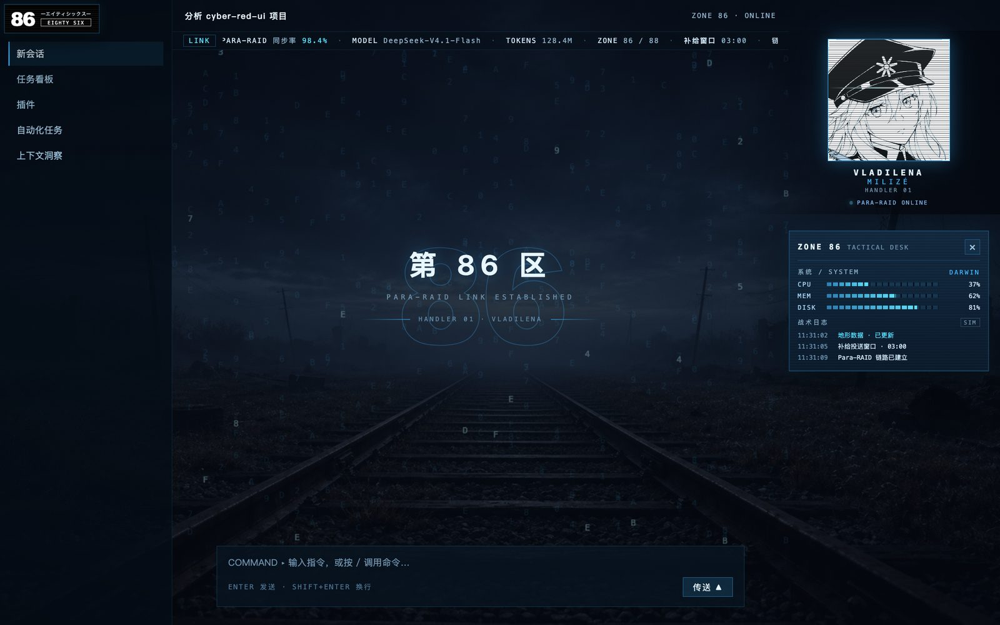
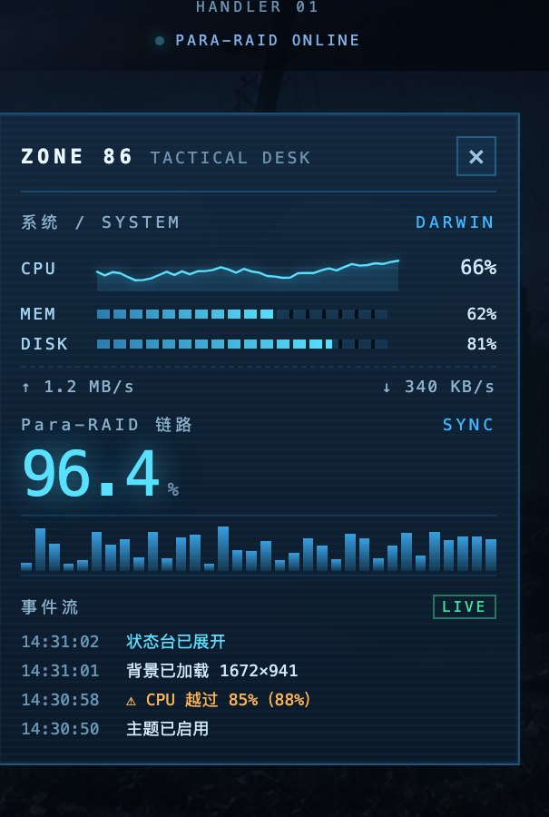
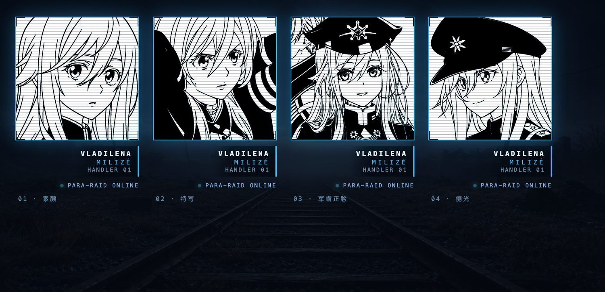
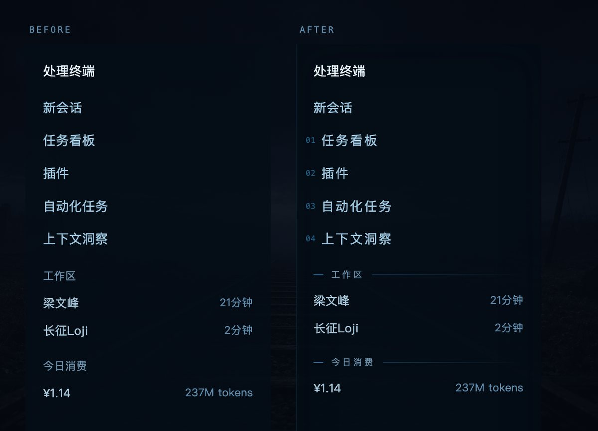
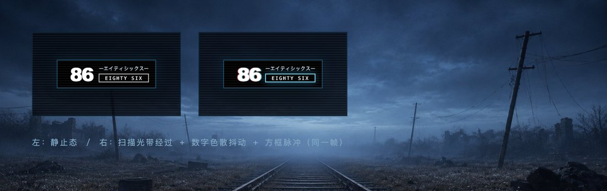
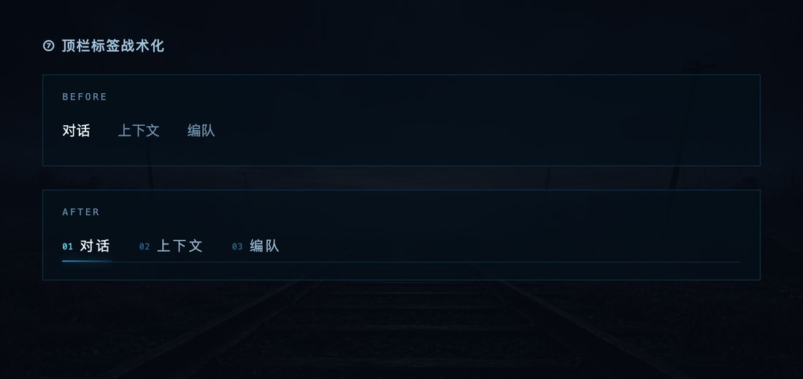

# 86 -不存在的战区- · DSH 皮肤插件

一个面向 **DeepSeek Harness** 的完整皮肤插件，不是纯 CSS 换色：
蓝黑底 + 青蓝线条 + 扫描层，右上角**蕾娜线稿 HUD**，右栏一座**第 86 区战术状态台**，
读的是本机真实指标，头像可以换，左上角锁标会自己动。



**快速开始：** `git clone` → `pnpm add link:` → 把 `dsh-86-zone-ui` 加进 `package.json` 的 `dsh.profile.bundles` → 重启。
详见 [安装](#安装)，Windows 与 macOS 各有完整步骤。

## 功能

### 视觉

| 功能 | 说明 |
|---|---|
| 背景画面 | 两套可选：**铁轨夜景**（`background.jpg`）与**花海**（`background-flowers.jpg`，由官方主视觉风格化而来），设置页一键切换 |
| 背景图 | 场景图铺在 `<html>` 上，基础面令牌转半透明让图透出来；四档强度（关 / 淡 / 中 / 浓）。切对话时会被壳层重置，插件用增量扫描 + 定期复检把它拉回来 |
| 左上 86 锁标 | 大号 86 + 片假名 + `[EIGHTY SIX]` 框，四层动效：扫描光带 6.5s、数字色散抖动 5.7s、片假名解码闪烁 4.3s、方框脉冲 3.9s —— 四个周期互质，永不整齐划一 |
| 头像动态 | 五层：**呼吸**（7s，缩放 3.2% + 上浮 3px）、**心跳**（3.7s，两次缩到 98.2% 并提亮）、**角标巡检**（14s，四角每 0.18s 依次点亮）、**描线入场**（换头像时 `clip-path` 自上而下"画"出来）、**事件闪烁**（状态台新增事件时边框闪 0.62s）。周期互质；设置里可整体关闭 |
| 右上 HUD 头像 | 线稿头像 + 四角框 + `VLADILENA MILIZÉ / HANDLER 01` 铭牌 + Para-RAID 指示灯；**5 张头像可切换**，状态台展开时放大居中变成该列页眉 |
| 装饰层 | 扫描线 / 技术网格 / 暗角 / 竖向扫光带，全部 `pointer-events: none` |
| 空会话彼岸花 | 没有任何对话时，一朵彼岸花从内容区右下角"开在屏幕外"，62% 不透明、缓慢绽开；一旦有消息就淡出。判定依据是 `[class*="markdown"]` 里有没有非空文本 —— 壳层唯一稳定的钩子，判定结果写进事件流 |
| COMMS 音乐 | 状态台里的播放器：四首曲目（AVID / Voices of the Chord / LilaS / Hands Up to the Sky），支持点选、播放/暂停、拖动进度、音量。音频文件**不入库**，由你放进 `assets/music/`；缺失时显示 `音源未接入` 并给出期望路径 |
| 机体档案 | 状态台里的一页「设定集」：M1A4「破坏神」三视图 + 规格表 + 战场姿态草图。纸面留在浅色，像一页真的图纸压在暗色面板上；可整块折叠 |
| Hex 数据雨 | 全窗口 canvas，约 11fps，径向遮罩让中心留空，窗口不可见时 `cancelAnimationFrame` |
| 空会话水印 | 86 描边字压在空会话主视觉后面，注册在 `conversation.hero.brand.mark` 槽位，有对话时自动消失 |
| 底部状态条 | 24px 滚动条，内容是真实 CPU / 内存 / 磁盘 / 负载 / uptime |
| 顶栏标签 | 「对话 / 上下文 / 编队」按文字定位后加编号与批示线 |
| 左侧栏 | 导航项编号 + 分组批示线 + hover 光条；主操作按钮「新会话」不编号、保持顶格。**当前项右侧一朵彼岸花**（正红 `#e2413f`，全界面唯一的红），编号同时转红 |
| 代码与滚动条 | 代码块左侧 2px 批示线，行内代码描边，链接改青蓝，8px 青色滚动条 |
| 账号区 | 账号行下方加 `HANDLER 01 · 管制指挥官 · ● PARA-RAID` 军阶行 |

### 战术状态台



可收起、可折叠分区，头部三个快捷开关（扫描线 / 数据雨 / 背景）加一个界面重载按钮。

| 区块 | 内容 |
|---|---|
| SYSTEM | **CPU 60 点迷你曲线**（2 秒一采样，两分钟窗口）、MEM / DISK 分段条、**网络上下行**（`netstat` 差分） |
| Para-RAID | 扇区雷达（`conic-gradient` 扫描面 + 三个错相光点）+ **同步率大读数**（由 CPU 反推，空载 ≈99%、满载 ≈82%）+ 34 根波形 |
| 事件流 | **真实事件**，不是假数据：主题启用、背景加载、CPU 跨过 85%、指标轮询失败、状态台开合、标签页与侧栏的识别结果 |
| 告警态 | CPU > 85% 或磁盘 > 90% 时，描边与同步率转橙红，标题栏出现「负载偏高」 |
| 页脚 | 主机名、UPTIME、RSS、**补给窗口倒计时**（指向下一个本地 03:00） |

### 设置页

「第 86 区」一页，共 18 项：

```
主题总开关 · 扫描线 · 技术网格 · 暗角 · 状态台亮度 · 头像亮度
预览（HUD / 锁标 / 状态台）
Hex 数据雨 · 空会话水印 · 顶栏标签战术化 · 底部状态条
背景图 · 左上 86 锁标 · 右上 HUD 头像 · 头像（5 选 1）· 头像呈现
状态台默认展开 · 侧栏名称 · 窗口标题 · 重置
```

## 截图

| ID 卡（5 张头像） | 左侧栏 |
|---|---|
|  |  |

| 锁标动效 | 顶栏标签 |
|---|---|
|  |  |

## 安装

四个步骤，macOS / Linux 与 Windows 各一份。**第 3 步是关键**，漏了不会生效。

### macOS / Linux

```bash
# 1. clone 到任意目录（不要放进 .dsh，升级时会被覆盖）
git clone https://github.com/JonathanChang-alt/dsh-86-zone-ui.git \
  ~/Documents/plugins/dsh-86-zone-ui

# 2. 用 link: 装进 profile（别用 cp，link 才能改完即时看到）
cd ~/.dsh/profiles/desktop
pnpm add link:$HOME/Documents/plugins/dsh-86-zone-ui

# 3. 编辑该目录下的 package.json，把下面这行加到 dsh.profile.bundles 末尾
#    "dsh-86-zone-ui"

# 4. 完全退出 DeepSeek Harness，再打开
```

### Windows（PowerShell）

**推荐用脚本，不要手改 JSON** —— 手工改 `package.json` 在 Windows 上有一个致命陷阱，详见下面的警告。

```powershell
# 1. clone
git clone https://github.com/JonathanChang-alt/dsh-86-zone-ui.git `
  "$env:USERPROFILE\Documents\plugins\dsh-86-zone-ui"

# 2. 跑安装脚本（会自动 link + 写 bundles + 校验，全程无 BOM）
cd "$env:USERPROFILE\Documents\plugins\dsh-86-zone-ui"
powershell -ExecutionPolicy Bypass -File .\install.ps1

# 3. 完全退出 DSH 再重开
```

如果你想手工做，第 2 步也可以拆成：

```powershell
cd "$env:USERPROFILE\.dsh\profiles\desktop"
pnpm add link:"$env:USERPROFILE\Documents\plugins\dsh-86-zone-ui"
notepad "$env:USERPROFILE\.dsh\profiles\desktop\package.json"
```

> ### ⚠️ 手工改 `package.json` 会让整个 DSH 起不来
>
> **Windows PowerShell 5.1 的 `Set-Content -Encoding UTF8` 会写入 UTF-8 BOM（`EF BB BF`）。**
> DSH 启动时用 Node 的 `JSON.parse` 读 profile 清单，它**不接受 BOM**：
>
> ```
> JSON.parse('\uFEFF{"name":"..."}')  →  SyntaxError: Unexpected token ''
> ```
>
> 后果不是「皮肤不生效」，而是**整个应用无法启动**，弹窗报
> `Unexpected token ' ', "{ ... is not valid JSON`。
>
> 更坑的是：**用 PowerShell / .NET 自查会通过**，因为 `ConvertFrom-Json` 容忍 BOM。
> 「我看过文件了，是合法 JSON」和「DSH 起不来」可以同时成立。
>
> 写完必须用 **Node** 校验（和宿主同一套解析）：
>
> ```powershell
> node -e "const fs=require('fs');const b=fs.readFileSync(process.argv[1]);if(b[0]===0xEF&&b[1]===0xBB&&b[2]===0xBF)throw new Error('has BOM');JSON.parse(b.toString('utf8'));console.log('OK')" "$env:USERPROFILE\.dsh\profiles\desktop\package.json"
> ```
>
> 仓库里也有现成的：`node tests/manifest.mjs <那个 package.json 的路径>`
>
> **已经崩了怎么救：** 崩溃弹窗里点第三个按钮
> **「Disable third-party plugins, back up profile patch, and restart」**，
> 或把 `bundles` 里的 `dsh-86-zone-ui` 删掉后重启。

第 3 步改完应该长这样（**注意逗号**）：

```json
"dsh": {
  "profile": {
    "bundles": [
      "@deepseek-ai/dsh-base",
      "@deepseek-ai/dsh-web-app",
      "dsh-86-zone-ui"
    ]
  }
}
```

### 也可以在插件管理器里装

DSH 的插件管理器有「添加本地插件」，指向 clone 下来的目录即可，它等价于第 1、2 步。
但装完之后**仍然要确认第 3 步**——插件管理器有时会把 `bundles` 重写成它自己的清单。

### 装完自检

重启后依次确认：

| 检查点 | 正常 | 不正常怎么办 |
|---|---|---|
| 右上角蕾娜头像 | 出现 | 见下方排查 |
| 设置页有「第 86 区」一栏 | 有 | 说明插件没被加载，`bundles` 写错了 |
| 左下角有「战术状态」按钮 | 有 | 同上 |
| 状态台里 CPU 有数字 | 有 | 宿主路由没起，检查是否完整重启（不是刷新） |

### 排查

| 现象 | 原因 |
|---|---|
| 设置页没有「第 86 区」 | `package.json` 的 `bundles` 里没加，或 JSON 语法错（多/少逗号） |
| 有设置页但没有头像 | `assets/avatar.png` 没被读到，确认 clone 完整 |
| 整个界面变黑或没反应 | 同时装了两个主题插件，先移除另一个 |
| 头像变成占位图形 | `/86-ui/avatar` 返回 404，检查 `assets/` 目录是否存在 |
| 指标全是 `—` | 宿主没重启（`index.js` 改动必须重启，刷新不够） |

> 只有宿主文件（`index.js`）改动需要重启；客户端（`client.js`）刷新界面即可。

## 平台支持

| 功能 | macOS | Windows | Linux |
|---|---|---|---|
| 皮肤 / HUD / 状态台 / 数据雨 / 事件流 | ✅ | ✅ | ✅ |
| CPU 曲线、同步率、内存 | ✅ | ✅ | ✅ |
| 磁盘占用 | ✅ | ✅ `fs.statfsSync` | ✅ |
| 网络上下行 | ✅ `netstat -ibn` | ✅ `netstat -e` | ➖ 显示 `—` |
| 负载 `loadavg` | ✅ | ➖ 恒为 0.00（系统没有此概念） | ✅ |
| 内存精确度 | ✅ `vm_stat` 修正 | ✅ 直接用 `os.freemem()` | ✅ |
| `install.sh` / `restore-profile.sh` | ✅ | ➖ 需 Git Bash 或 WSL | ✅ |

Windows 上装插件用 pnpm 即可，两个 shell 脚本只是便利工具：

```powershell
cd $env:USERPROFILE\.dsh\profiles\desktop
pnpm add link:$env:USERPROFILE\Documents\plugins\dsh-86-zone-ui
```

## 宿主路由

三条只读本地路由，**没有任何第三方外联**：

| 路由 | 内容 |
|---|---|
| `GET /86-ui/metrics` | CPU / 内存 / 磁盘 / 负载 / 网络吞吐 / RSS / uptime |
| `GET /86-ui/avatar?art=NN` | 头像；`NN` ∈ `01..04` 时取 `assets/portraits/NN.png`，其余回退 `assets/avatar.png` |
| `GET /86-ui/background` | 背景图；`?scene=rail\|flowers` 选择画面，未知值回退默认 |

都先过 `connection.requestRejection(req)` 鉴权闸门。

macOS 上内存用 `vm_stat` 修正（`os.freemem()` 会把缓存算成已用，显示约 99%），
网络用 `netstat -ibn` 的累计字节做差分 —— 固定 argv、不拼 shell、不读用户输入。

## 结构

```
client.js          浏览器侧全部内容，单文件（约 125 KB）
index.js           宿主侧路由与采样（约 12 KB）
assets/            背景图、默认头像、4 张可选头像
docs/              README 用的截图（preview/ 是工作目录，不进仓库）
assets/background-flowers.jpg   花海场景
scripts/           头像描线与主视觉合成脚本（PIL）
tests/             205 项检查，见下
install.sh         一键安装（macOS / Linux）
install.ps1        一键安装（Windows，用 Node 写 JSON，天然无 BOM）
PITFALLS.md        这个项目踩过的坑，动手前值得先读
PROMPTS.md         生图提示词（头像 / 背景 / 主视觉）
```

## 测试

```bash
node tests/selfcheck.mjs   # 57  静态红线：无外联、无 base64、对比度、体积
node tests/contract.mjs    # 29  插件契约：槽位注册、主题令牌、卸载清理
node tests/host.mjs        # 38  路由：鉴权、MIME、字节一致、?art= 回退
node tests/audit.mjs       # 67  跨文件一致性：设置键、字段、类名、残留引用
node tests/render.mjs      # 14  渲染冒烟：用桩 React 真跑每个槽位组件
node tests/manifest.mjs    # 10  清单卫生：BOM、JSON.parse、bundles 内容
```

`audit` 与 `render` 是为两类真实事故加的：

- **静默失效**：`store.get('x')` 拼错、宿主少发一个字段、类名没有对应样式 —— 语法检查全都看不见
- **整棵槽位消失**：某个组件渲染时抛错，React 会把整个 slot 卸掉（曾经表现为「状态台突然不见了，但头像还在」）

## 说明

个人同人作品，角色与作品名归原作者所有，不含任何官方素材。
头像由生成模型产出后经脚本处理（二值化 → 加粗 → 降采样），并非直接描摹官方图。
仅供学习与自用，请勿商用。

## 许可

MIT
